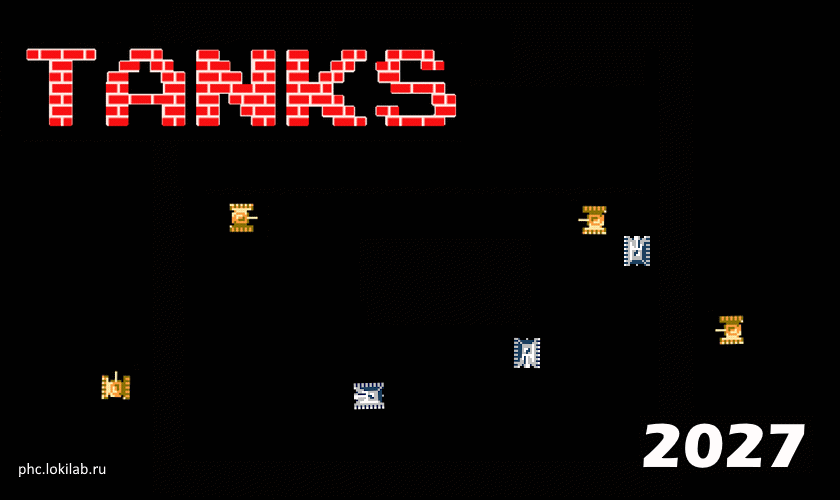

# Tanks 2027



Port of Battle City / Tank 1990 to the **PS Vita**, based on [krystiankaluzny/Tanks](https://github.com/krystiankaluzny/Tanks).
The game is written in C++11 and uses the SDL2 2D graphics library.

## Game modes

- **Classic** — the classic Battle City campaign: clear 13 stages, protect your eagle.
- **Generated** — endless procedurally generated stages of increasing difficulty.
- **Survival** — survive as long as you can against an endless stream of enemies.
- **Deathmatch** — destroy the enemy base at the top of the map while defending your own eagle at the bottom. Dropping the enemy base wipes all remaining enemies and completes the stage. Before the battle you can set the difficulty (EASY / MEDIUM / HARD) and enable an AI friend tank.

High scores are tracked separately for every mode.

## Profiles

Player profiles are stored on the memory card (`ux0:data/tanks/profiles/`). Up to 6 characters per name, selectable on startup.

## Controls (PS Vita)

- Move: D-Pad
- Fire: Cross
- Pause: Start (RETURN / MAIN MENU)
- Confirm: Cross, Back: Circle
- Deathmatch setup: Cross / Left / Right to change, Start to play, Circle to go back

## Extras

- Bonus items: grenade, helmet, clock, shovel, tank, star, gun, boat.
- Enemy types A–D with different armour levels and behaviour, hunters (red) and base destroyers in Deathmatch.
- AI friend tank (optional, Deathmatch).

## Building for PS Vita

### Requirements

- [VitaSDK](https://vitasdk.org/) (e.g. installed to `C:\vitasdk`)
- CMake
- Python 3 (for `vita-pack-vpk` assets step)

### Build

In the project directory run:

```powershell
powershell -ExecutionPolicy Bypass -File .\build_vita.ps1
```

As a result **build-vita** directory should be created with **Tanks.vpk**.
Copy it to your Vita and install (e.g. via VitaShell).

## Building for PC (original)

The original desktop build via `Makefile` (Linux / Mac / Windows-MinGW) is kept intact — see instructions below.

### Linux / Mac

```sh
sudo apt install libsdl2-dev libsdl2-ttf-dev libsdl2-image-dev libsdl2-mixer-dev   # Debian/Ubuntu
brew install sdl2 sdl2_ttf sdl2_image sdl2_mixer                                    # Mac
make clean run
```

### Windows (MinGW)

```sh
mingw32-make.exe clean run
```

## Enemies

Each enemy may fire only one bullet at the same time.
If bullet hits a target, a brick or a stage border and explodes then the enemy may fire next one bullet.
Enemies may have one of four different armour levels. Each level have a different colour.
When a player bullet hits an enemy, it's armor level decrease.
If the armour level falls to zero, then enemy will be destroyed.

If enemy blinks, each hit create new bonus item on a map.

### Enemy types

 - A type:
    - target: closest player or eagle;
    - speed: base;
    - behaviour: 80% chance to move towards the target, 20% chance to move in random direction,
      constantly fires in movement direction
 - B type:
    - target: eagle;
    - speed: 1.3 * base;
    - behaviour: 50% chance to move towards the target, 50% chance to move in random direction,
      constantly fires in movement direction
 - C type:
    - target: eagle;
    - speed: base;
    - behaviour: 50% chance to move towards the target, 50% chance to move in random direction,
      constantly fires in movement direction
 - D type:
    - target: closest player or eagle;
    - speed: base;
    - behaviour: 50% chance to move towards the target, 50% chance to move in random direction,
      fires if target is in front of

## Bonus items

 - Grenade: all enemies are destroyed
 - Helmet: active player shield for 10 seconds
 - Clock: freeze all enemies for 8 seconds
 - Shovel: create stone wall around eagle for 15 seconds
 - Tank: increase player lives count
 - Star: increase player speed, each next one increases max bullets count
 - Gun: same as three stars
 - Boat: allows to move on the water

## Stages

Stages are plain text files located in **stages** directory.
Each stage is a two-dimensional array with 26 rows and 26 columns.
Each field in the array should be one of following elements:

 - **.** Empty field
 - **#** Brick wall: it can be destroyed with two bullets or one if you collect three Stars or Gun
 - **@** Stone wall: it can be destroyed only if you collect three Stars or Gun bonus
 - **%** Bush: it can be erased only if you collect three Stars or Gun bonus
 - **~** Water: it is natural obstacle unless you collect Boat bonus
 - **-** Ice: tanks are slipping on it

## License

See [LICENSE](LICENSE). Original game: [krystiankaluzny/Tanks](https://github.com/krystiankaluzny/Tanks).
